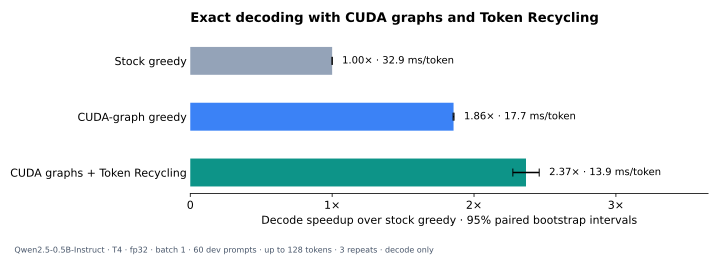

# Swarm Token Prediction

**2.37× faster decoding with identical output.** CUDA graphs plus 30-node Token
Recycling on **Qwen2.5-0.5B-Instruct, NVIDIA T4, fp32, batch size 1**. Measured on
60 Spec-Bench dev prompts, up to 128 generated tokens each, across three repeats.
The measurement covers decoding only; prefill, model loading, graph capture, and
warm-up are excluded. All measured outputs matched stock greedy token for token.



CUDA-graph greedy decoding delivers **1.86×** over the stock Hugging Face loop.
Token Recycling adds **1.28×** on top, reaching **2.37×** overall
(95% paired bootstrap interval: **2.27–2.46×**).

## How it works

The stock decode step leaves the GPU idle for 58–61% of its wall time in the
[recorded profile](results/fp32/profile.json). The fast decoder preallocates its
KV cache and captures the fixed-shape step in a CUDA graph, reducing Python and
kernel-launch overhead.

Token Recycling stores each token's top-eight successors in a lookup table.
It proposes 30 draft nodes, verifies the tree in one target-model forward pass,
and accepts the path that agrees with greedy predictions. Drafting, verification,
table updates, and KV compaction run in one captured round. No draft model or
training is needed. The tree has 30 draft nodes plus its root.

## Install and generate

Python 3.11+ and a CUDA GPU. The recorded run used Python 3.13.16,
PyTorch 2.11.0+cu130, and Transformers 5.22.1.

```bash
python3 -m venv .venv
source .venv/bin/activate
python -m pip install torch==2.11.0 --index-url https://download.pytorch.org/whl/cu130
python -m pip install -e '.[dev]'
python examples/generate.py "Explain how a rainbow forms." --check
```

The first generation downloads the model. `--check` compares the generated token
IDs with the stock greedy loop.

```python
from swarm_token_prediction import create_decoder, encode_chat, load_model

tokenizer, model = load_model("cuda")
decoder = create_decoder(model, cache_size=1600)
ids = encode_chat(tokenizer, "Explain how a rainbow forms.", "cuda")
result = decoder.generate(ids, max_new=128)
print(tokenizer.decode(result["tokens"], skip_special_tokens=True))
```

The cache must fit the prompt, requested generation, and 31 tree slots. The
recycling table persists between prompts; `decoder.reset_table()` clears it.
Decoders process one prompt at a time and are not thread-safe.

## Reproduce

Regenerate the chart and summary from saved records, without running the model:

```bash
python benchmarks/report.py
```

This verifies the archived file hashes and reproduces the original timings,
speedups, and confidence intervals. The [900 timing records](results/fp32/timings.jsonl)
cover the three displayed decoders plus the A/A and root-only controls.
[Provenance](results/fp32/provenance.json) records the selection, environment, and hashes. The original run did not record a model revision.

Run the selected benchmark on a CUDA GPU:

```bash
python benchmarks/run.py --out results/runs/reproduction
```

The runner uses the saved 30 warm-up and 60 dev prompts, a 1600-slot cache,
three repeats, shuffled configuration order, and exact token checks. It resets
the recycling table before each configuration/repeat, fills it on warm-up
prompts, then carries it across scored prompts. Decode timing excludes the first
generated token, which comes from prefill. Results include paired bootstrap
intervals, the A/A timing check, and a root-only tree control against fast greedy.

For local CPU checks, install the same PyTorch version from the
`https://download.pytorch.org/whl/cpu` index in the install command above, then:

```bash
python -m pytest -q
python examples/generate.py --device cpu --max-new 8 --check
```

CPU checks execute the same decoding logic without CUDA graph capture. The speed
claim is the recorded T4/fp32/dev result.

## Credits

- [Token Recycling](https://arxiv.org/abs/2408.08696): the lookup-table drafting and tree-verification method.
- [Spec-Bench](https://github.com/hemingkx/Spec-Bench/tree/fd2c1cd7d2201ef71db4c5f4e455008f017967bf): prompts and draft-tree template.
- [Qwen2.5-0.5B-Instruct](https://huggingface.co/Qwen/Qwen2.5-0.5B-Instruct): target model.

Apache-2.0. See [LICENSE](LICENSE) and [NOTICE](NOTICE).
